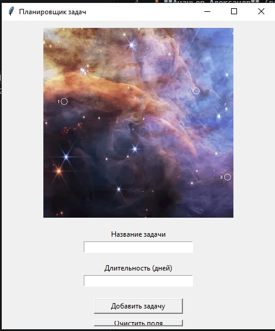

# Планировщик задач

## Участники команды
* **Ананьев Александр** (разработчик)
* **Игорь Игорович** (заказчик и тестировщик)

## Назначение
Приложение для планирования задач на Python с использованием библиотеки Tkinter.

## Техническое задание
* Размер окна: `460x520`
* Фото в приложении: баннер (`baner.png`)
* Поля ввода: название задачи и длительность в днях
* Кнопки: «Добавить задачу» и «Очистить поля»
* Счётчик добавленных задач

## Скриншот



## Запуск
Для запуска надо запустить программу `app.py`:
```bash
python app.py